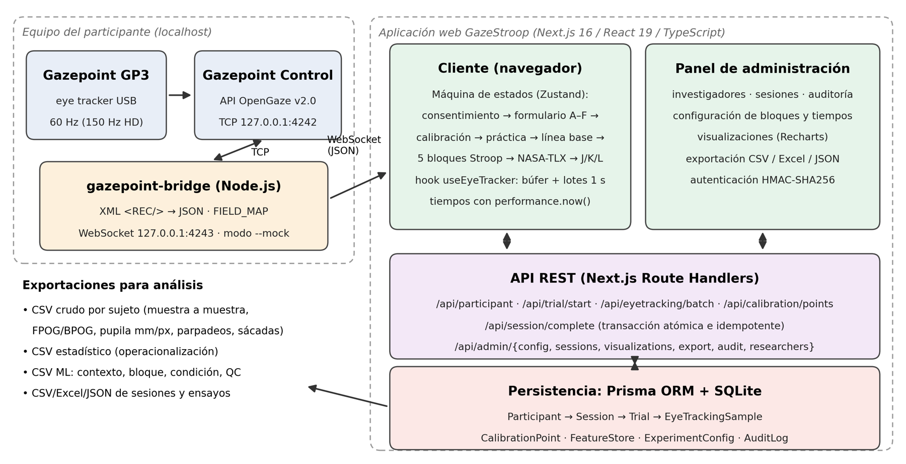
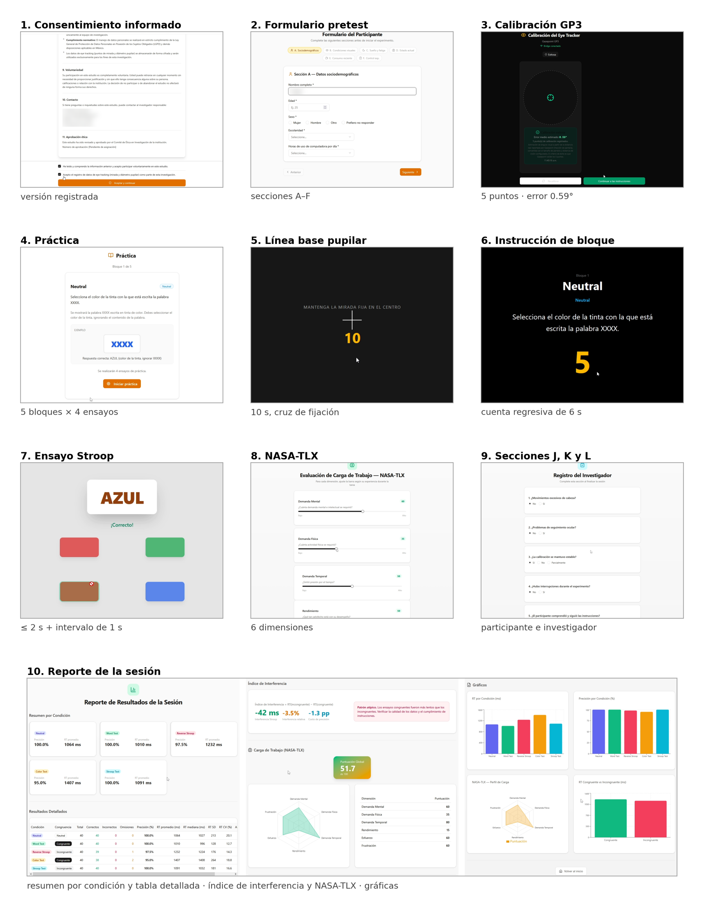

# GazeStroop

[](https://doi.org/10.5281/zenodo.23355413) [](LICENSE)

**An open-source web platform for multimodal Stroop experiments with synchronized eye tracking, pupillometry and NASA-TLX.**

GazeStroop administers a computerized Stroop paradigm and records, synchronized with each trial, the participant's behavioral, ocular and subjective responses. It implements five configurable conditions (Neutral, Word, Reverse Stroop, Color and Stroop) with balanced stimulus generation, and integrates with the **Gazepoint GP3** eye tracker through a small local bridge that translates the OpenGaze API to WebSocket. An administration panel lets researchers configure the protocol, audit sessions, visualize results and export datasets ready for statistical analysis and machine learning.

> GazeStroop is a **research instrument**. It does not perform any clinical or neuropsychological diagnosis.



## Features

- **Complete session protocol (10 steps):** informed consent (versioned), pre-test questionnaire (sections A–F), 5-point eye-tracker calibration, practice with its own color palette, 10 s pupil baseline, experimental blocks, NASA-TLX, post-task sections J/K/L and a session report.
- **Five Stroop conditions:** Neutral (`XXXX`), Word, Reverse Stroop, Color and Stroop. Block order, trials per block (4–48), exposure time, inter-trial interval and instruction time are configurable.
- **Balanced trials:** congruent/neutral blocks assign N/4 trials to each color; incongruent blocks distribute trials evenly over the 12 non-matching word–ink pairs; option positions are randomized.
- **Eye tracking per trial:** every gaze, fixation, pupil and blink sample is stored with its session, trial and phase (`trial` / `baseline`). Pupil diameter in mm and px, BPOG/FPOG, camera-image data and blinks are kept raw.
- **Behavioral metrics:** reaction time (via `performance.now()`), accuracy, errors, omissions, anticipatory responses, per-block mean/median/SD/CV, Stroop interference, relative interference and accuracy cost.
- **Administration panel:** researchers, sessions (detail report, exclusion), protocol configuration, visualizations, exports and audit log, protected with HMAC-signed session tokens.
- **Exports:** raw per-participant CSV (sample level), statistical CSV (trial level), complete CSV (participant level), session report, four ML-ready tables (subject context, block level, condition summary, quality control) and Excel/JSON.
- **Mock mode:** `gazepoint-bridge --mock` streams a synthetic 60 Hz signal (flagged `simulated: true`) to develop and test without hardware.



## Requirements

| Component | Version / notes |
|---|---|
| Node.js | ≥ 20 (with npm) |
| Browser | Chromium-based (Chrome, Edge) recommended |
| Eye tracker | Gazepoint GP3 / GP3 HD with **Gazepoint Control** running (optional if you use mock mode) |
| OS | Windows, macOS or Linux |

## Installation

```bash
git clone https://github.com/vgomezmex/GazeStroop.git
cd GazeStroop
npm install

# 1. Environment variables
cp .env.example .env          # then edit ADMIN_SESSION_SECRET

# 2. Create the SQLite database
npx prisma db push

# 3. Create the first administrator (access code + name)
node scripts/create-admin.mjs MY-ADMIN-CODE "Lab administrator"
```

### Run

**For experimental sessions use the production build** (the development server compiles on demand and can introduce timing jitter):

```bash
npm run build
npm start                     # http://localhost:3000
```

For development only:

```bash
npm run dev
```

> When using `npm start` (standalone build), prefer an absolute path in `DATABASE_URL`, e.g. `file:/home/lab/GazeStroop/db/custom.db`.

## Connecting the Gazepoint GP3

The browser cannot open raw TCP sockets, so a small relay runs on the participant's computer:

```
GP3 (USB) → Gazepoint Control → TCP 127.0.0.1:4242 → gazepoint-bridge → WS 127.0.0.1:4243 → browser
```

1. Open **Gazepoint Control** and check that both eyes are detected.
2. Start the bridge and keep the terminal open during the session:
   ```bash
   cd gazepoint-bridge
   npm install
   npm start          # real device
   # npm run mock     # synthetic signal, no hardware needed
   ```
3. In **Admin panel → Configuration → Eye Tracker**, check the bridge URL (`ws://127.0.0.1:4243`), the physical screen width (cm) and the viewing distance (cm). The last two are used to convert the calibration error to degrees of visual angle.

All OpenGaze attribute names are mapped in a single table (`FIELD_MAP` in `gazepoint-bridge/bridge.mjs`); see [`gazepoint-bridge/README.md`](gazepoint-bridge/README.md) for details and troubleshooting.

## Running a session

1. On the home screen, select the researcher and press **Iniciar Sesión** (a participant code is generated automatically if left empty).
2. The participant reads and accepts the consent, completes the pre-test form, and the researcher runs the **calibration** (success requires the 5 points validated by Gazepoint).
3. Practice → pupil baseline → experimental blocks → NASA-TLX → sections J, K and L.
4. The session report is shown at the end and remains available in **Admin panel → Sessions**.

Fill in the consent fields (study, researcher, institution, contact and ethics approval number) in **Admin panel → Configuration** before the first real session.

## Data export

| Format | Granularity |
|---|---|
| Raw CSV per participant | One row per eye-tracking sample (baseline and trials) with response and derived saccades |
| Statistical CSV | One row per trial with pre-test, block, session and post-test variables |
| Complete CSV | One row per participant |
| Session report CSV | One row per condition of a session |
| ML: subject context / block level / condition summary / QC | Analysis-ready tables, including gaze and pupil validity |
| Excel / JSON / CSV | Participants, sessions and trials |

Data model: `Participant → Session → Trial → EyeTrackingSample` (+ `CalibrationPoint`, `FeatureStore`, `ExperimentConfig`, `AuditLog`). See `prisma/schema.prisma`.

## Data protection

- Never commit `.env` or the database file (`db/*.db`): the database contains participant data. Both are excluded in `.gitignore`.
- Participants are identified by alphanumeric study codes; exports can be anonymized.

## Project structure

```
gazepoint-bridge/     Node.js relay: OpenGaze TCP → WebSocket (real and --mock modes)
prisma/               Database schema (SQLite)
scripts/              Build helper and create-admin script
src/app/api/          REST endpoints (participant, trial, eye tracking, session, admin)
src/components/       Experiment screens and administration panel
src/hooks/            useEyeTracker (WebSocket client, batching, calibration)
src/stores/           Session state machine (Zustand) and trial generation
src/types/            Conditions, colors and data types
```

## How to cite

If you use GazeStroop, please cite the software: https://doi.org/10.5281/zenodo.23355413 (see also [`CITATION.cff`](CITATION.cff)). The article describing the software is currently under review.

## License

[MIT](LICENSE) © 2026 Víctor Alberto Gómez-Pérez, Alejandro Jarillo-Silva, Armida González-Lorence, Sonia Mendoza, Omar Arturo Domínguez-Ramírez and Verónica Rodríguez-López.

## Contact

- Sonia Mendoza — sonia.mendoza@cinvestav.mx (Departamento de Computación, CINVESTAV-IPN)
- Alejandro Jarillo-Silva — ajarillo@unsis.edu.mx (Laboratorio de Interacción Humano-Computadora, Universidad de la Sierra Sur)

## Acknowledgements

Developed within the project *"Diseño y validación de un paradigma Stroop computarizado mediante eye tracking para evaluar interferencia y carga cognitiva"* at the Human-Computer Interaction Laboratory, Universidad de la Sierra Sur (Mexico).
